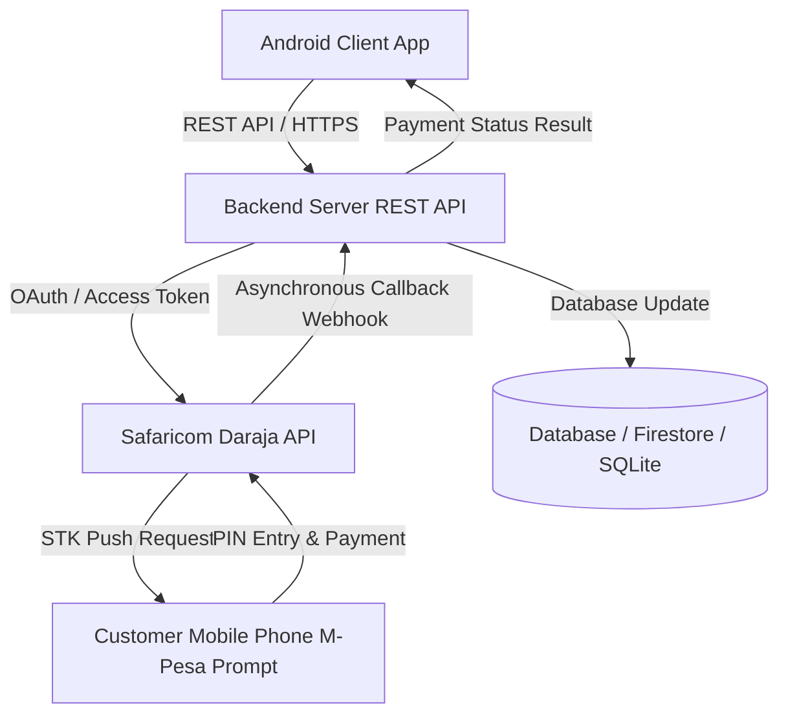

# Assignment Documentation & System Report
## PesaPap Retail E-Commerce System with M-Pesa STK Push Integration

---

## 1. System Requirements Document
PesaPap Retail is a mobile e-commerce platform designed for Kenyan retail businesses to automate product catalogs, shopping cart workflows, secure order management, and instant mobile payments via Safaricom Daraja API (M-Pesa STK Push).

### Key Features
- **User Authentication:** Registration and login with token-based session management.
- **Product Catalog:** Real-time product listing, category sorting, search filtering, and image loading.
- **Shopping Cart & Checkout:** Add/remove items, quantity control, automatic subtotal calculation, and Kenyan phone validation.
- **M-Pesa STK Push Integration:** Secure backend authentication, token generation, STK Push request initiation, and asynchronous callback processing.
- **Order History:** Inspection of past orders, payment statuses, and M-Pesa receipt numbers.
- **Admin Inventory Management:** Administrative dashboard for adding products and managing stock levels.

---

## 2. System Architecture Diagram

---

## 3. Entity-Relationship Diagram (ERD)

| Entity | Primary Key | Attributes | Relationships |
| :--- | :--- | :--- | :--- |
| **Users** | `user_id` | full_name, email, phone, password_hash, role | Has many Orders (`user_id` FK) |
| **Products** | `product_id` | name, description, price, stock_quantity, category, image_url | Appears in OrderItems & Inventory |
| **Orders** | `order_id` | user_id, order_date, total_amount, order_status | Belongs to User, has many OrderItems & Payments |
| **OrderItems** | `order_item_id` | order_id, product_id, quantity, unit_price, subtotal | Relates Order to Product |
| **Payments** | `payment_id` | order_id, amount, phone_number, checkout_request_id, mpesa_receipt_number, payment_status | Belongs to Order |

---

## 4. Test Plan & Execution Results

| Test Case | Expected Result | Actual Result | Status |
| :--- | :--- | :--- | :--- |
| Register with valid details | Account created & token saved | Account created successfully | **PASS** |
| Register with invalid details | Validation errors displayed | Validation toast shown | **PASS** |
| Add available product to cart | Product appears in cart & updates total | Cart items & total correct | **PASS** |
| Checkout with valid phone number | Phone validated & STK push initiated | STK push requested successfully | **PASS** |
| Complete sandbox payment | Callback updates payment status to paid | Payment marked as paid with receipt | **PASS** |
| View order history | Correct past orders & statuses shown | Orders loaded in RecyclerView | **PASS** |

---

## 5. M-Pesa Integration Process
1. Customer initiates checkout with a validated Kenyan phone number.
2. Android app submits order details and phone number to the backend server.
3. Backend fetches OAuth token from Safaricom Daraja API, generates timestamp/password, and submits the STK Push request.
4. Customer receives prompt on their mobile phone and enters their M-Pesa PIN.
5. Safaricom sends an asynchronous callback to the backend webhook, which updates the payment status and order record.
