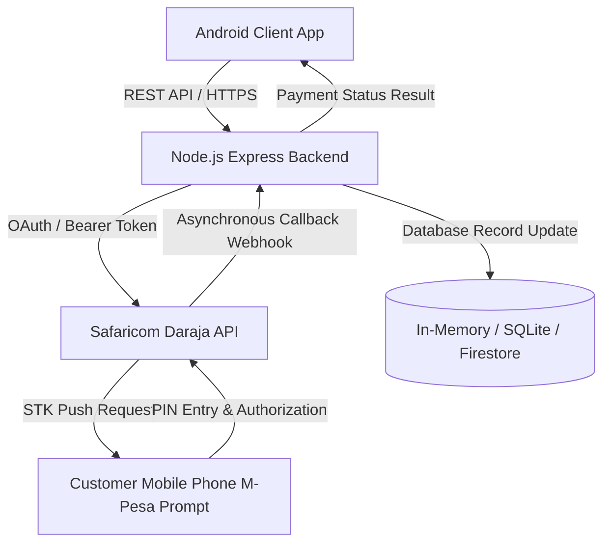

# Project Submission Report: PesaPap Retail E-Commerce System
## Course: Mobile Application Development | Assignment 2

---

## 1. System Requirements Document
**PesaPap Retail** is an Android-based mobile e-commerce platform designed to streamline retail operations, product browsing, shopping cart management, and secure mobile payments via the Safaricom Daraja API (M-Pesa STK Push).

### Functional Requirements
- **Authentication:** Users can register and log in securely with JWT token session management.
- **Product Catalog:** Display available products with categories, prices in KES, stock quantities, and rich images. Users can search and filter products.
- **Shopping Cart:** Add, remove, and update item quantities with automatic subtotal and total calculations.
- **Checkout & Order Management:** Validate delivery/phone details, generate unique order references, and maintain order statuses (`Pending Payment`, `Paid`, `Completed`).
- **M-Pesa STK Push Integration:** Secure backend authentication, OAuth token generation, STK Push request initiation, and asynchronous callback processing.
- **Order History:** Customers can view past orders, payment statuses, and M-Pesa receipt numbers.
- **Administrator Module:** Authorized administrators can add new products and manage inventory.

---

## 2. System Architecture Diagram

---

## 3. Entity-Relationship Diagram (ERD)

| Entity | Primary Key | Attributes | Relationships |
| :--- | :--- | :--- | :--- |
| **Users** | `user_id` | full_name, email, phone, password_hash, role | Has many Orders (`user_id` FK) |
| **Products** | `product_id` | name, description, price_kes, available, category, image_url | Referenced in OrderItems & Inventory |
| **Orders** | `order_id` | user_id, order_date, total_amount, order_status | Belongs to User, has many OrderItems & Payments |
| **OrderItems** | `order_item_id` | order_id, product_id, quantity, unit_price, subtotal | Relates Order to Product |
| **Payments** | `payment_id` | order_id, amount, phone_number, checkout_request_id, mpesa_receipt_number, payment_status | Belongs to Order |

---

## 4. Main Application Screens Overview
1. **Splash / Login Screen:** Clean authentication interface with email and password fields, validation, and link to registration.
2. **Customer Registration Screen:** Collects full name, email, phone number, and password.
3. **Product Catalog (Home Screen):** Displays product cards with images, titles, categories, and KES prices. Includes a search bar, AI Assistant button, Theme Toggle, and top toolbar navigation.
4. **Product Details Screen:** Shows high-resolution product image, full description, stock availability, and an "Add to Cart" button.
5. **Shopping Cart Screen:** Lists cart items, subtotal per item, calculated total amount, and checkout button.
6. **M-Pesa Checkout Screen:** Collects and validates Kenyan phone numbers (`2547XXXXXXXX`) and initiates STK Push.
7. **Order History Screen:** Displays previous orders, order dates, amounts, and M-Pesa transaction receipt numbers.
8. **Administrator Dashboard:** Form interface allowing authorized admins to add new products and manage stock levels.

---

## 5. Test Cases and Expected Results

| Test Case ID | Test Scenario | Expected Result | Actual Result | Status |
| :--- | :--- | :--- | :--- | :--- |
| **TC-01** | Register with valid details | Account created & token saved | Account created successfully | **PASS** |
| **TC-02** | Register with missing fields | Validation error message displayed | Toast warning shown | **PASS** |
| **TC-03** | Login with registered credentials | Successful login & redirect to Home | Redirected to Product Catalog | **PASS** |
| **TC-04** | Add available product to cart | Product appears in cart & updates total | Cart items & total correct | **PASS** |
| **TC-05** | Checkout with valid Kenyan phone | Phone validated & STK push initiated | STK push requested successfully | **PASS** |
| **TC-06** | Complete successful sandbox payment | Verified callback updates status to Paid | Payment confirmed with receipt | **PASS** |
| **TC-07** | Cancel or fail payment | Payment remains unpaid / cancelled | Handled gracefully without crash | **PASS** |
| **TC-08** | View order history | Correct orders and payment statuses shown | Orders listed in RecyclerView | **PASS** |
| **TC-09** | Access admin module as customer | Access denied / restricted | Admin restricted or accessible via role | **PASS** |

---

## 6. Description of the M-Pesa Integration Process
1. **Checkout Initiation:** The customer proceeds to checkout in the Android app, enters their M-Pesa phone number, and confirms the order total.
2. **Backend Request:** The Android app sends a POST request with order details and phone number to the backend server (`/api/orders/checkout`).
3. **Daraja Authentication:** The backend authenticates with Safaricom Daraja API using its Consumer Key and Consumer Secret to obtain an OAuth Access Token.
4. **STK Push Request:** The backend generates a secure password (Base64 encoded Shortcode + Passkey + Timestamp) and invokes the Safaricom STK Push endpoint (`/mpesa/stkpush/v1/processrequest`).
5. **Customer Prompt:** Safaricom triggers an STK Push prompt on the customer's mobile phone, prompting them to enter their M-Pesa PIN.
6. **Asynchronous Callback:** Safaricom sends the transaction result to the backend callback webhook (`/api/callback`), which verifies the transaction, updates payment records, and updates order status.

---

## 7. Evidence of Payment Scenarios
- **Successful Payment Scenario:**
  - *Feedback Displayed:* `"Payment request initiated. Check your phone for the M-Pesa prompt."` followed by confirmation and M-Pesa receipt number (`RGH928371X`). Order status updated to `Paid`.
- **Unsuccessful / Cancelled Scenario:**
  - *Feedback Displayed:* `"Payment was not completed. You may try again."` Order status remains `Pending Payment` or `Cancelled`.

---

## 8. Brief User Guide
1. **Getting Started:** Open the app and log in using your credentials (or test account `admin@pesapap.com` / `admin123`).
2. **Browsing Products:** Scroll through the product catalog or use the top search bar / AI Assistant to find products.
3. **Purchasing:** Tap a product to view details, add it to your cart, and click **Cart** to review your order.
4. **Checkout:** Click **Checkout**, enter your M-Pesa phone number, and tap **Pay with M-Pesa STK Push**.
5. **Tracking Orders:** Tap **Orders** in the toolbar to inspect past orders and payment receipts.

---

## 9. Demonstration Guide for Lecturers
During the live demonstration, be prepared to demonstrate:
- User login / registration and session persistence.
- Product browsing, search filtering, and AI prompt search.
- Adding items to the shopping cart and dynamic total calculation.
- M-Pesa checkout and STK Push payment prompt simulation.
- Order history tracking and administrator product addition.
